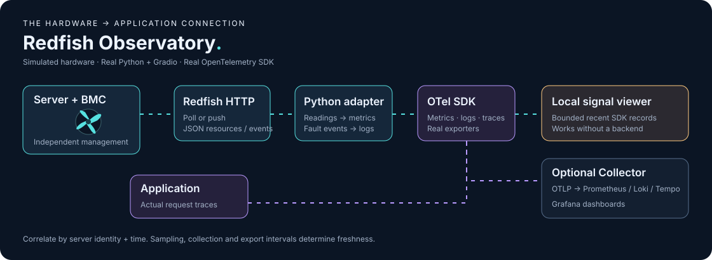
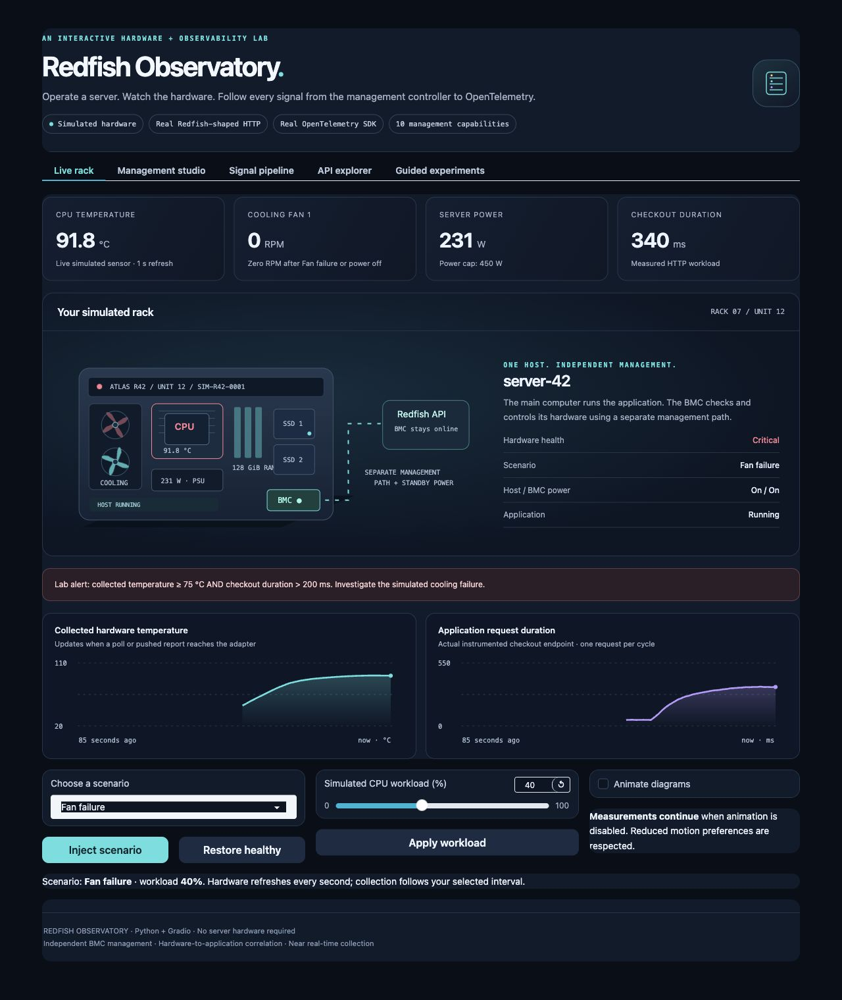

# Redfish Observatory

**Learn server management and near real-time observability by operating a simulated rack.**

An illustrated Python + Gradio project: spinning fans, animated signal paths, changing sensor charts, executable Redfish management lessons, and actual OpenTelemetry metrics, logs, and traces. No server hardware or observability backend is needed to start.



Redfish is the server's remote management interface. OpenTelemetry gives hardware readings and application behavior a common way to reach an observability system. This lab lets you see both sides working together.

## Run in two minutes

Use **Python 3.11 or 3.12**.

```bash
git clone https://github.com/sivalinb/redfish-observability-lab.git
cd redfish-observability-lab
python3 -m venv .venv
source .venv/bin/activate
python -m pip install -e .
python app.py
```

Open **http://127.0.0.1:7860**. On Windows, activate with `.venv\Scripts\activate` instead. The installed `redfish-lab` command also starts the app. Use `python app.py --port 7861` if the port is occupied.



## Try this first

1. Open **Live rack** and click **Inject scenario** with **Fan failure** selected.
2. Watch fan 1 stop. The CPU warms up; after roughly 15–25 seconds the actual checkout request takes longer. The highlighted lab alert requires collected temperature ≥ 75 °C **and** duration > 200 ms.
3. Open **Signal pipeline**. A temperature is a **metric**, a fan fault is a **log**, and the checkout's request journey is a **trace**. Expand the exported records to see real SDK output and trace IDs.
4. Restore healthy. Try **Polling only** with a 12-second interval. Fail the fan again and compare the live sensor with the collected chart. Then select **Push reports + events**.
5. Try **OS crash**. The application returns 503; Redfish continues answering because the BMC has an independent management path.

The six **Guided experiments** explain these steps inside the app. Turn off **Animate diagrams** to pause decorative motion while measurements continue; system reduced-motion preferences are respected.

## What you can operate

Every management lesson includes a plain-language explanation, animated request flow, editable parameters, request preview, actual HTTP response, and resulting state.

| Capability | Experiment | Result |
| --- | --- | --- |
| Hardware inventory | Read the system; follow its component links | CPU, memory, serial number, drives and firmware inventory |
| Health and sensors | Inject fan, power-supply or disk failure | Temperature, RPM, power and health change |
| Remote power | Shutdown, start or restart the host | Host changes state while the BMC stays online |
| Energy and power caps | Set a 150–600 W budget | Simulated power is limited to that budget |
| BIOS configuration | Stage virtualization, then restart | Pending settings become active |
| Firmware updates | Start a demo update | HTTP 202, Task progress, then a new BMC version |
| Boot source | Set a one-time disk, PXE, CD or USB override | The next boot uses the chosen source |
| Virtual media / OS provisioning | Attach an installer, choose CD, restart | A simplified installation Task completes |
| Storage | Create RAID0/RAID1 volume metadata | A new volume appears in inventory |
| Accounts and roles | Create a demo account; attempt a write as ReadOnly | Role enforcement returns HTTP 403 |
| Logs and event subscriptions | Read stored logs or receive callbacks | New faults become OTel logs; stored entries are deduplicated |
| Telemetry reports | Inspect MetricReportDefinitions and MetricReports | Periodic push reports feed OTel measurements |

The ten Management studio lessons cover the first ten rows; the API explorer and Signal pipeline cover logs, events and telemetry reports.

## What is real, and what is simulated?

**Real:** Python, Gradio, FastAPI HTTP routes, REST methods/statuses, parameter validation, the OpenTelemetry SDK, metrics/log/span exporters, measured request durations, trace parents, and optional OTLP/HTTP export.

**Simulated:** server hardware, sensors, faults, firmware flashing, BIOS effects, OS installation, RAID allocation and accounts. Installer/firmware URLs are recorded without downloading anything. The simulated heat/latency relationship is an intentional teaching model; it is not a prediction for a real server.

This is a **Redfish-shaped teaching subset**, not a Redfish-conformant implementation. `X-Lab-Role` illustrates permissions and is not authentication. UI clients make HTTP requests through httpx's in-process ASGI transport; curl and external clients reach those same routes over TCP. All Gradio controls target the simulator. Each browser session has separate hardware state and OTel providers; the unauthenticated REST default is the shared `public-demo` session. Keep this local development lab on loopback.

## How near real time works

```text
BMC sensors ── REST polling or pushed MetricReports ── Python adapter ── OTel metrics
BMC faults  ── EventService HTTP callback or log polling ─────────────── OTel logs
Application ── instrumented checkout + child operations ─────────────── OTel traces
                                                                        │
                                                       bounded local viewer
                                                       + optional OTLP/HTTP
                                                                        │
                                                      Collector → backends
```

The simulator samples every second. Collection is independently configurable from 1–15 seconds. Local SDK metric export is every second; external metric export is every three seconds, with batched external logs/traces. There is no hard real-time guarantee: sensor sampling, collection, transport, export and dashboard refresh all add delay.

Signals share `host.name=server-42` and `lab.physical_server.id=SIM-R42-0001`. Each browser gets a unique `service.instance.id` so external metric series stay separate. Hardware events correlate with application activity by **server identity and time**. They are not assigned invented request trace IDs. Application logs emitted inside a request carry its actual trace context.

| Signal | Example | SDK instrument / source |
| --- | --- | --- |
| Metric | `lab.hardware.temperature` in `Cel` | Observable gauge from collected Redfish readings |
| Metric | `lab.hardware.fan.speed` in `{revolution}/min` | Observable gauge |
| Metric | `lab.hardware.power` in `W` | Observable gauge |
| Metric | `lab.hardware.health` (0 OK / 1 warning / 2 critical) | Teaching gauge |
| Metric | `lab.application.request.duration` in `s` | Histogram of measured HTTP workload duration |
| Metric | `lab.application.requests` | Request counter |
| Log | Fan failure or slow checkout | Actual OTel LogRecord export |
| Trace | `checkout.request` → `inventory.lookup` + `database.write` | Actual parent/child spans with measured timings |

The `lab.*` namespace deliberately identifies these teaching metrics. The local viewer retains bounded recent data and loses it when the app stops. It is not a storage backend.

## Optional: Collector + Grafana + Prometheus + Loki + Tempo

With Docker and Docker Compose installed, stop any app already using port 7860, then run:

```bash
docker compose up --build -d
docker compose logs -f collector
```

- Gradio: **http://127.0.0.1:7860**
- Grafana: **http://127.0.0.1:3000/d/redfish-observatory** (pre-provisioned dashboard)
- Prometheus: **http://127.0.0.1:9090**
- OTLP/HTTP Collector: **http://127.0.0.1:4318**

Open the lab, inject a fault and allow a few collection/export cycles. Choose your simulated rack session in Grafana. The dashboard plots temperature, fan RPM, power and mean checkout duration; its log and trace panels search all lab sessions. Use Grafana Explore with **Loki** for logs and **Tempo** for traces. Grafana's development image permits anonymous access on these loopback ports.

The separate Collector forwards all three signals to the LGTM image's ingest Collector, which routes them to Prometheus, Loki and Tempo. The supplied stack is for local development; data is disposable and no production authentication or durable volumes are configured. Stop it with `docker compose down`.

To keep Python on your host and run only the backend:

```bash
docker compose up -d collector lgtm
export OTEL_EXPORTER_OTLP_ENDPOINT=http://127.0.0.1:4318
python app.py
```

This project explicitly uses **OTLP HTTP/protobuf**. Set the Collector origin, without a `/v1/metrics` suffix; the app appends the three signal paths. Without that environment variable, nothing is sent to an external backend. A configured endpoint in the diagram means configuration exists, not that a backend has acknowledged delivery. The app does not automatically load `.env`.

## HTTP examples

With the app running:

```bash
curl http://127.0.0.1:7860/redfish/v1
curl http://127.0.0.1:7860/redfish/v1/Systems/1
curl http://127.0.0.1:7860/redfish/v1/Chassis/1/Thermal
curl -X POST http://127.0.0.1:7860/redfish/v1/Systems/1/Actions/ComputerSystem.Reset \
  -H 'Content-Type: application/json' -d '{"ResetType":"GracefulShutdown"}'
curl http://127.0.0.1:7860/redfish/v1/Managers/1
curl -X POST http://127.0.0.1:7860/redfish/v1/Systems/1/Actions/ComputerSystem.Reset \
  -H 'Content-Type: application/json' -d '{"ResetType":"On"}'
```

These operate on `public-demo`, separate from your browser's private simulation. Pass `X-Lab-Session: my-experiment` to isolate an external experiment. See [the API guide](docs/API.md) for firmware Tasks, BIOS, callbacks and report examples. `python examples/simulator_client.py` demonstrates discovery over actual loopback HTTP.

## Optional: observe a real BMC (read only)

The separate [hardware example](examples/observe_hardware.py) discovers Systems/Chassis links and reads supported temperature, fan RPM and power measurements. It uses HTTPS certificate verification, does not follow cross-origin links or redirects, and exposes only GET operations. It is not connected to the Gradio controls. Use an observer account and your organization's CA bundle when needed.

```bash
export BMC_URL=https://bmc.example
export BMC_USERNAME=observer
# Optional: export BMC_CA_BUNDLE=/path/to/your/ca.pem
python - <<'PY'
import getpass, os, runpy, sys
os.environ['BMC_PASSWORD'] = getpass.getpass('BMC observer password: ')
sys.argv = ['observe_hardware.py', '--once']
runpy.run_path('examples/observe_hardware.py', run_name='__main__')
PY
```

It exports metrics to the console, or to OTLP if the endpoint variable is set. For continuous observation, omit `--once` (default interval 30 seconds; minimum 5). Modern Sensors are discovered first; legacy Thermal/Power is used when Sensors is absent. Unsupported units and missing readings are skipped. Vendor pagination, session authentication, events and hardware write workflows are outside this optional example. The adapter is fixture-tested; validate it on your BMC before relying on its data.

## Development and project map

```bash
python -m pip install -e '.[dev]'
python -m pytest -q
python -m pip check
```

Tests cover management state transitions, permission denials, asynchronous completion, invalid writes, session isolation, polling delays, HTTP callbacks, event deduplication, trace relationships, sensor discovery, escaping, motion controls and OTLP protobuf serialization for all three signals. GitHub Actions runs the Python suite and an optional-stack smoke check. [Architecture notes](docs/ARCHITECTURE.md) explain the modules and timing.

```text
redfish_lab/model.py       Simulated hardware and management state
redfish_lab/api.py         Redfish-shaped API, callbacks and checkout workload
redfish_lab/runtime.py     Session registry, polling and callback delivery
redfish_lab/telemetry.py   Actual OTel SDK providers and exporters
redfish_lab/visuals.py     SVG rack, charts, animated flows and lessons
redfish_lab/app.py         Gradio tabs and controls
redfish_lab/readonly.py    Separate HTTPS GET-only hardware client
examples/                 Simulator client and opt-in hardware observer
infra/                    Collector and Grafana provisioning
tests/                    Behavioral tests and stack smoke check
```

## Learn from the standards

- [DMTF Redfish overview](https://www.dmtf.org/standards/redfish) explains the management standard.
- [Redfish specification](https://redfish.dmtf.org/schemas/DSP0266_1.20.1.html) defines resources, actions, Settings, Tasks and events.
- [DMTF Telemetry white paper](https://www.dmtf.org/sites/default/files/standards/documents/DSP2051_1.1.0.pdf) describes periodic and event-driven metric reports and sample timestamps.
- [OpenTelemetry concepts](https://opentelemetry.io/docs/what-is-opentelemetry/) and [Python exporters](https://opentelemetry.io/docs/languages/python/exporters/) explain the signals and SDK integration.
- [Prometheus OTLP guide](https://prometheus.io/docs/guides/opentelemetry/) explains metric-name translation and resource labels.
- [Grafana's LGTM development stack](https://github.com/grafana/docker-otel-lgtm) provides the optional backend.

MIT licensed. This is an independent educational project; Redfish, OpenTelemetry, Gradio and Grafana belong to their respective projects.
